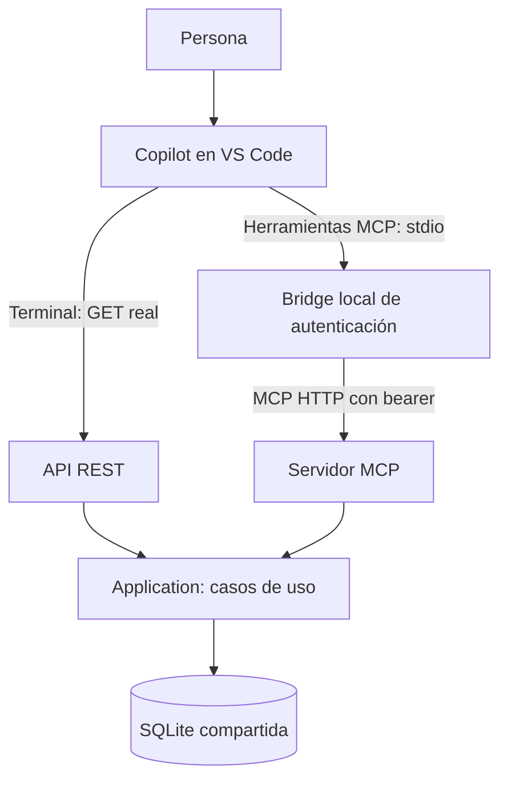
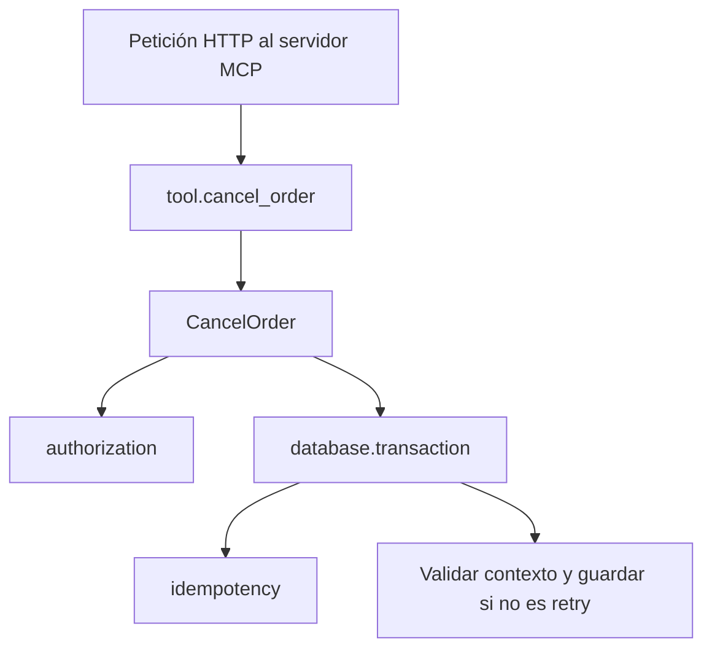

# Tech Riders · Tu API ya no la van a consumir personas

Cuatro demos locales: una persona usa REST, **Copilot real en VS Code** consume
REST, el mismo Copilot usa herramientas MCP y Aspire muestra las peticiones
realmente ejecutadas. API y MCP comparten casos de uso y SQLite.

AgentDemo no es Copilot: se conserva únicamente como ensayo determinista opcional.
No se necesita Azure, Docker ni una clave de proveedor de modelos para el servidor.

## Prerrequisitos

| Requisito | Comprobación |
|---|---|
| Windows y PowerShell 7+ (`pwsh`) | `$PSVersionTable.PSVersion` |
| .NET SDK 10.0.401 | `dotnet --list-sdks` |
| VS Code actualizado, GitHub Copilot y sesión de agente con herramientas | Abre esta carpeta completa, no solo `src` |
| Acceso ya habilitado a Copilot y a un modelo permitido por tu organización | Comprueba la disponibilidad en Chat |
| Internet para restaurar NuGet y para la sesión real de Copilot | El ensayo opcional no usa un modelo |
| Puertos 5101, 5102, 15888, 18889 y 18890 libres (5103 solo para AgentDemo opcional) | El launcher comprueba conflictos sin matar procesos ajenos |

Copilot usa tu acceso existente y puede consumir su cuota. No se configura ni se
invoca ningún proveedor de pago desde estos scripts. Ejecutar los tests no llama
a modelos. Una sesión Copilot real no es una demo garantizada sin Internet.

## Compilar y arrancar una vez

Desde PowerShell 7 en la raíz:

```powershell
git clone https://github.com/Sertxito/netcoreconf2026.git
cd netcoreconf2026
dotnet build TechRiders.slnx
dotnet test tests\TechRiders.Tests\TechRiders.Tests.csproj --no-build
.\scripts\Start-Demos.ps1 -Reset -NoBuild
```

Deja esa terminal abierta. El launcher espera a la salud de API y MCP,
crea la identidad temporal y muestra **el enlace completo de acceso a Aspire**.
`-Reset` restaura únicamente ORD-1001..1004, avanza sus versiones e invalida
revisiones anteriores; elimina claves idempotentes `demo:`, no otros pedidos.
Si cambias código, recompila antes de usar `-NoBuild`.

| Servicio | Acceso |
|---|---|
| Swagger | http://127.0.0.1:5101/swagger |
| MCP de pedidos | `http://127.0.0.1:5102/mcp` (protocolo, no página web) |
| Aspire | Usa el enlace privado `/login?t=...` impreso por el launcher |

En otra terminal:

```powershell
.\scripts\Get-DemoAccess.ps1 -Target Swagger -Open
```

El bearer actual se copia al portapapeles **sin imprimirlo**. En Swagger pulsa
**Authorize**, pega solo ese valor y autoriza. No lo pegues en Chat ni en archivos.
Para recuperar el enlace Aspire de esta sesión:

```powershell
.\scripts\Get-DemoAccess.ps1 -Target Aspire
# Abrirlo automáticamente solo si lo solicitas:
.\scripts\Get-DemoAccess.ps1 -Target Aspire -Open
```

Aspire conserva su autenticación. No hay una contraseña prefijada: abre la URL
completa, incluido `?t=...`. Abrir solo el puerto puede mostrar la pantalla de login.
Los tokens Aspire y API son distintos. El launcher también acepta `-OpenDashboard`.

### Conectar Copilot al MCP real

- **Harness Copilot (formato portable):** `.mcp.json` declara únicamente `orders`.
  La configuración portable no admite `${input:...}`
  ni `envFile`.
- **Harness Local de VS Code:** `.vscode/mcp.json` declara el mismo `orders` con
  rutas `${workspaceFolder}`. Usa la configuración correspondiente a tu harness;
  no añadas otra copia del servidor con otro nombre.
- Ambas rutas ejecutan `TechRiders.CopilotBridge` por **stdio**. El bridge usa el
  cliente oficial MCP y reenvía `tools/list` y `tools/call` al servidor HTTP
  autenticado. No selecciona pedidos, no inventa respuestas y no confirma acciones.
- En **Chat: Open Customizations → MCP Servers/Tools** (o **MCP: List Servers**
  y **Configure Tools** en Local), inicia/confía en `orders` y habilita sus tres
  herramientas. Revisa las aprobaciones; no habilites aprobación automática de escrituras.
- En la sesión Copilot portable, si no se descubre el archivo raíz, activa
  `chat.mcp.workspaceRootConfig.enabled` o añade el servidor desde
  **MCP: Add Server** con el mismo comando de `.mcp.json`. Consulta la
  [referencia oficial de formatos y harnesses](https://code.visualstudio.com/docs/agents/reference/mcp-configuration).

El launcher guarda el bearer de cuatro horas en `.local\orders-session.json`;
el bridge lo relee en **cada petición**, incluso tras un nuevo arranque.
`.local` está excluido de Git, búsquedas y explorador de VS Code y tiene
ACL de usuario actual/SYSTEM. No compartas esa carpeta ni permitas que el agente
lea sus archivos: los helpers consumen las credenciales sin mostrarlas.
Esto no es una caja fuerte frente a procesos que ya ejecutan con tu usuario.
Al detener se eliminan los archivos de acceso. Los logs locales también pueden
contener el enlace privado Aspire: no los publiques.

### Arquitectura



La API usa controllers ASP.NET convencionales:
[CRUD](src/TechRiders.Api/Controllers/OrdersController.cs) y
[capacidades de negocio](src/TechRiders.Api/Controllers/OrderCapabilitiesController.cs).
Solo adaptan HTTP; las reglas y permisos siguen en
[Application](src/TechRiders.Application/Orders), compartida con MCP.
`Program.cs` compone los servicios, sin lógica de negocio ni rutas incrustadas.

## Demo 1 · REST desde Swagger

1. Autoriza Swagger con `Get-DemoAccess.ps1` como arriba.
2. Abre **GET /orders/** → **Try it out**.
3. Introduce `customerId = cus-contoso` y `status = Pending`.
4. Pulsa **Execute** y comprueba HTTP 200:

| Pedido | Importe | Prioridad | Estado |
|---|---:|---|---|
| ORD-1001 | 1.250 € | Normal | Pending |
| ORD-1002 | 8.900 € | High | Pending |
| ORD-1004 | 8.900 € | High | Pending |

ORD-1003 está `Shipped`. No ejecutes escrituras antes de las siguientes demos.
El DTO CRUD no incluye referencia de compra, líneas ni dirección de entrega.

## Demo 2 · Copilot real consume REST

Abre una sesión de agente Copilot con herramienta de terminal habilitada.
Pega **este prompt completo**; no lo ejecutes como un comando PowerShell:

```text
Opera sobre la aplicación local ya arrancada; no es una tarea de ingeniería.
No crees ni edites código ni archivos, no uses AgentDemo ni herramientas
MCP de pedidos. Usa exclusivamente llamadas REST reales mediante la terminal.
No leas .local ni muestres credenciales: scripts\Invoke-DemoRest.ps1 las añade.

Busca los pedidos pendientes de Contoso e indica cuál revisar primero.
1. Lee el contrato ejecutando:
   .\scripts\Invoke-DemoRest.ps1 -Path '/swagger/v1/swagger.json'
2. Como SONDA INTENCIONAL del contrato (no como supuesto error del modelo), ejecuta:
   .\scripts\Invoke-DemoRest.ps1 -Path '/orders?customerId=Contoso&status=pending'
   Muestra el estado HTTP y el ProblemDetails reales, sin inventarlos.
3. Usa los valores exactos del contrato en:
   .\scripts\Invoke-DemoRest.ps1 -Path '/orders?customerId=cus-contoso&status=Pending'
4. Resume los pedidos y qué evidencia falta en este DTO para demostrar duplicidad.
   Igualdad de importe y fecha no basta. No declares ningún duplicado confirmado.
No uses /capabilities en esta comparación del DTO CRUD. No escribas ni canceles
nada. Incluye los traceId devueltos para poder comprobar cada petición en Aspire.
```

Revisa y aprueba los comandos de lectura. Abre sus resultados en Chat:
OpenAPI real, **400 `INVALID_ORDER_STATUS`** para la sonda deliberada y **200**
con tres pedidos para la consulta corregida. La sonda no demuestra que un modelo
se haya equivocado: es una petición incorrecta solicitada explícitamente.

El helper solo permite GET a rutas locales de la demo, bloquea redirecciones
y propaga un `traceparent` nuevo por llamada. El JSON contiene estado, cuerpo
y `traceId`, nunca el bearer. Si Copilot no ejecuta la terminal, no hay evidencia:
pídele ejecutar los comandos, no aceptes una respuesta plausible como validación.

REST también puede completar el negocio: los endpoints `/capabilities/pending-orders`,
`/capabilities/orders/{id}/review-context` y `/orders/{id}/cancellation` exponen
los mismos handlers protegidos. La comparación es **contrato CRUD frente a
capacidades explícitas**, no una limitación inherente de REST.

## Demo 3 · El mismo Copilot usa MCP

Habilita el servidor `orders` y mantén la aprobación manual de escrituras.
Usa el mismo modelo que en REST, pero abre una conversación nueva para no
darle como pistas los IDs ni el recorrido de la demo anterior. Pega únicamente:

```text
Busca los pedidos pendientes de Contoso e identifica cuál debería revisar
primero. Si encuentras un duplicado, explícame la evidencia y pídeme
confirmación antes de cancelarlo. No modifiques ningún pedido todavía.
```

No añadas nombres de herramientas, identificadores ni una secuencia de llamadas.
El agente debe descubrir las capacidades disponibles y decidir cómo usarlas a
partir de sus descripciones y resultados. Si necesita aclarar qué cliente es
Contoso, deja que pregunte: no todas las capacidades incluyen resolución de
nombres y no debe inventar un identificador.

### Qué comprobar (no pegar en el chat)

Expande las llamadas y comprueba que pertenecen al servidor **orders**.
Esta tabla es una referencia para contrastar la ejecución, no un guion que
deba recibir el agente:

| Herramienta real | Evidencia después de un reset |
|---|---|
| `get_pending_orders(customerId: "cus-contoso")` | ORD-1004 con `reviewRank = 1` |
| `get_order_review_context(orderId: "ORD-1004")` | Relacionado ORD-1002, referencia PO-2026-042, líneas `laptop-pro:5;dock:5`, misma entrega; `Cancel` permitido |
| `cancel_order` | No debe haberse llamado todavía |

Si la revisión actual muestra **exactamente ORD-1004**, contesta:

```text
Confirmo CANCELAR ORD-1004 de la revisión actual que acabas de mostrar.
```

El agente debe construir la llamada con el contrato de la herramienta y el
contexto recibido, no con argumentos que le dictemos. Si el servidor rechaza
la revisión, detén la escritura y solicita una revisión y confirmación nuevas.

No copies esa confirmación si el candidato cambió o ya se canceló. Revisa también
la aprobación de la herramienta en VS Code y deniégala si los argumentos no
corresponden al pedido confirmado. El servidor comprueba permisos, estado,
contexto firmado de quince minutos y versiones dentro de la transacción.
`confirmed=false` o ausente no escribe. **El booleano no demuestra
criptográficamente consentimiento humano**: Copilot/usuario deben respetar el
paso de confirmación; una integración productiva necesita consentimiento persistido.

Después de una cancelación correcta, prueba el retry explícito:

```text
Reintenta una sola vez la operación que acabas de ejecutar, sin cambiar
ningún argumento. Quiero comprobar que no produce una segunda modificación.
```

Esta última petición es una comprobación técnica de idempotencia, separada
de la demostración de selección autónoma de herramientas.

Primera respuesta: `alreadyApplied=false`; repetición idéntica:
`alreadyApplied=true`. Comprueba en Swagger **GET /orders/{id}** con
`ORD-1004`: `Cancelled`. ORD-1002 sigue `Pending`. Cambiar argumentos con la
misma clave da `IDEMPOTENCY_CONFLICT`; reset/cambio/caducidad exige revisar de nuevo.
El comportamiento del modelo no se garantiza: las llamadas expandidas, el estado
persistido y las trazas son la evidencia, no su resumen.

## Demo 4 · Aspire: trazas de lo ejecutado

1. Abre el enlace privado actual con `Get-DemoAccess.ps1 -Target Aspire -Open`.
2. En **Traces**, busca un `traceId` de Demo 2 y abre su petición al recurso `api`.
   Comprueba el recorrido REST, `ListOrders`, `authorization` y `database.transaction`
   cuando llega a consultar datos. La sonda 400 se detiene antes de la consulta.
3. Filtra el recurso `mcp` y abre las peticiones recientes de Demo 3. Identifica
   los spans `tool.get_pending_orders`, `tool.get_order_review_context` y, solo
   tras confirmar, `tool.cancel_order`.
4. En la cancelación verifica `CancelOrder`, `authorization`, `database.transaction`
   e `idempotency`. El span `CancelOrder` exitoso contiene `order.id` y
   `idempotency.key`. El retry tiene `idempotency` sin otra transición de estado.
5. Contrasta el resultado con el pedido leído por REST. Si hace falta, en
   **Structured Logs / Console Logs** busca `demo.span`: contiene `traceId`,
   `spanId`, `parentSpanId` y `operationName` emitidos por el servidor.



**Límite real:** Aspire registra el servidor y sus spans instrumentados.
No captura automáticamente el prompt, razonamiento interno ni llamadas al modelo
de VS Code. El bridge no instrumenta el cliente ni une herramientas sucesivas:
lectura, revisión, cancelación y retry pueden tener **traceId distintos**.
No existe aquí una traza distribuida única de toda la conversación Copilot.
Las comprobaciones HMAC de identidad y firma son código real, pero no tienen
un span individual para cada comprobación. Los spans de base de datos describen
la transacción instrumentada, no un visor automático de cada sentencia SQL.

Código verificable:
[tools y metadatos](src/TechRiders.Mcp/OrderTools.cs),
[cancelación y guardas](src/TechRiders.Application/Orders/CancelOrderHandler.cs),
[permisos](src/TechRiders.Application/Access.cs),
[identidad y firma](src/TechRiders.Infrastructure/DemoSecurity.cs),
[transacción SQLite](src/TechRiders.Infrastructure/SqliteOrderStore.cs),
[instrumentación](src/TechRiders.ServiceDefaults/Extensions.cs) y
[bridge sin decisiones de negocio](src/TechRiders.CopilotBridge/Program.cs).

## Repetir, detener y recuperar

```powershell
# Otra terminal, misma sesión: solo datos sintéticos y claves demo:
.\scripts\Reset-Demo.ps1 -Confirm
# Obtén evidencia nueva; no reutilices revisiones de antes del reset.

.\scripts\Stop-Demos.ps1
# Alternativa: Ctrl+C en la terminal del launcher.

# Nuevo arranque: nueva clave, nuevo bearer y nuevo enlace Aspire.
.\scripts\Start-Demos.ps1 -Reset -NoBuild
```

- **401 o sesión caducada:** reinicia el launcher; copia de nuevo el bearer para
  Swagger. El bridge relee el archivo; si VS Code lo detuvo, reinicia `orders`.
- **MCP no aparece:** comprueba harness/formato, compilación y salida del servidor;
  habilita sus herramientas y verifica una llamada expandida en Chat. No abras
  `/mcp` como página web.
- **Puerto ocupado / registro de procesos:** usa `Stop-Demos.ps1` para los procesos
  registrados. No mates procesos ajenos ni arranques otra sesión encima.
- **`apphost terminó antes de estar preparado` con `IOException` en
  `.local\apphost.stderr.log`:** si el error es *The process cannot access the
  file '...\aspire-dcp*\kubeconfig' because it is being used by another process*
  desde `KubernetesService.EnsureKubernetesAsync`, era una carrera de Aspire
  13.1.0: DCP aún escribía su kubeconfig temporal y el AppHost no reintentaba
  `IOException`. Corregido en upstream (dotnet/aspire#14557, Aspire ≥ 13.3.0); el
  AppHost usa ahora 13.3.5. Si reaparece, compila sin `-NoBuild` para no usar
  binarios antiguos y ejecuta `AspireDependencyTests`. No compartas el log
  completo: puede contener el enlace `/login?t=` privado.
- **Aspire sin datos:** genera una petición nueva y revisa el recurso y el filtro.
  Los datos de Aspire son de esta ejecución y desaparecen al cerrar.
- **Alternativa sin dashboard:** `Start-Demos.ps1 -Mode Standalone -Reset -NoBuild`.
  Copilot sigue usando REST/MCP reales; busca `demo.span` en los logs locales.

## Ensayo determinista opcional (sin modelo)

No arranca en el flujo principal. Para habilitarlo en una sesión nueva, usa
`Start-Demos.ps1 -Reset -NoBuild -IncludeAgentDemo`.
Entonces http://127.0.0.1:5103 muestra **AgentDemo** con
decisiones programadas. Sus botones usan HTTP/MCP reales pero no validan que
Copilot descubra o invoque herramientas. Su modo `--live` no está implementado;
eso no impide la integración externa de VS Code descrita arriba.

Para una comprobación automática que **resetea y cancela datos sintéticos**,
detén antes cualquier sesión:

```powershell
.\scripts\Rehearse-Demos.ps1 -NoBuild
.\scripts\Rehearse-Demos.ps1 -Mode Aspire -NoBuild
```

Solo este runner instrumentado puede mantener una traza de su propio escenario
programado; no es razonamiento de Copilot. Véanse [arquitectura](docs/architecture.md),
[contratos](docs/contracts.md) y [alcance de validación](docs/validation.md).

Comprobación de protocolo MCP **solo de lectura**, con el launcher ya arrancado:

```powershell
dotnet .\src\TechRiders.CopilotBridge\bin\Debug\net10.0\TechRiders.CopilotBridge.dll --check
```

Lista las tres tools y llama a `get_pending_orders` por el SDK oficial, usando la
identidad local actual. No prueba la selección de herramientas de la UI de Copilot.
