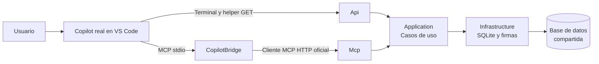
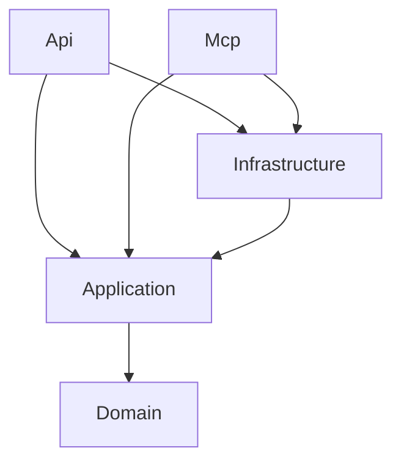
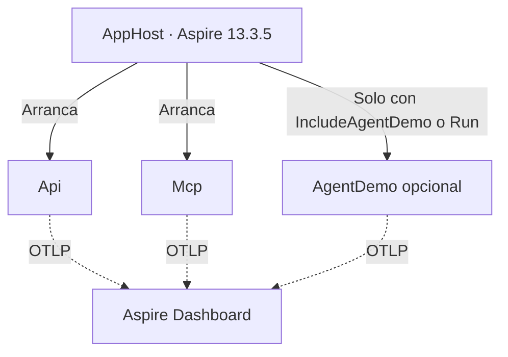
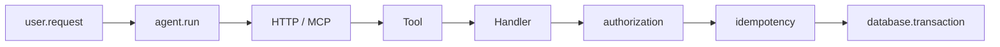

# Arquitectura greenfield implementada

## Evidencia y alcance

Cuatro demos locales en quince minutos: consulta REST manual, Copilot con REST,
Copilot con herramientas MCP de pedidos y observabilidad con Aspire. El recorrido
reproducible está en el [README](../README.md) y las
[notas del ponente](demo-runbook.md).

## Recorrido de una petición

Las flechas anteriores representan el recorrido en ejecución. Las siguientes
representan **referencias entre proyectos**, no peticiones de red.

## Dependencias del núcleo

Application declara las interfaces de persistencia y firma. Infrastructure
las implementa. Mcp no depende de Api.

## Orquestación y observabilidad

ServiceDefaults configura la instrumentación compartida (ASP.NET, HttpClient
y spans de negocio). Tests usa xUnit con Kestrel real en puertos efímeros.

## Proyectos

| Proyecto | Responsabilidad |
|---|---|
| Domain | Estados, evidencia de duplicación, orden de revisión y seeds |
| Application | `GetPendingOrdersHandler`, `GetOrderReviewContextHandler`, `CancelOrderHandler`, CRUD restringido, contratos, permisos e interfaces |
| Infrastructure | SQLite transaccional, emisor/verificador Demo de identidad y contextos firmados |
| Api | Controllers REST, composición MVC/Swagger/OpenAPI, ProblemDetails compartidos con ServiceDefaults |
| Mcp | SDK C# oficial; `AddMcpServer().WithHttpTransport().WithToolsFromAssembly()` y `MapMcp("/mcp")`; no referencia Api |
| CopilotBridge | Proxy stdio/HTTP sin decisiones de negocio; reenvía contratos y resultados con credencial local actual |
| AgentDemo | Ensayo opcional determinista: cliente oficial MCP, cliente HTTP/OpenAPI, CLI y pantalla de confirmación humana |
| ServiceDefaults | Exportación OTLP cuando AppHost la configura; logs JSON como alternativa |
| AppHost | Recursos de proyecto sin Docker, salud y dependencias; dashboard oficial |
| Tests | Reglas + contratos + auth + confirmación + idempotencia + integración real |

## Decisiones conscientes

- **Controllers delgados, no otra capa de negocio.** Siguiendo la separación usada en TR, [OrdersController](../src/TechRiders.Api/Controllers/OrdersController.cs) adapta CRUD y [OrderCapabilitiesController](../src/TechRiders.Api/Controllers/OrderCapabilitiesController.cs) las capacidades. Se conservan rutas, nombres OpenAPI y respuestas sin introducir `/api`, envelopes, MediatR ni autenticación cloud. [ApiServiceCollectionExtensions](../src/TechRiders.Api/ApiServiceCollectionExtensions.cs) conserva el contrato JSON y la semántica de query strings al pasar de Minimal APIs a MVC.
- **Casos de uso localizables.** [Application/Orders](../src/TechRiders.Application/Orders) separa handlers, DTOs y validación; [Abstractions](../src/TechRiders.Application/Abstractions) declara persistencia/firma, y `Access`/`BusinessException`/`Telemetry` mantienen las preocupaciones compartidas. La huella de evidencia se comparte sin que cancelar dependa del handler de revisión. [Registration](../src/TechRiders.Infrastructure/Registration.cs) compone SQLite, firma, autenticación y handlers sin mezclarlos con el emisor.
- **Validación en el mismo orden.** MVC rechaza cuerpos JSON inválidos y parámetros obligatorios ausentes, pero no antepone validación implícita de strings a los errores del negocio. `status=pending`, vacío o repetido sigue siendo inválido, no un filtro ignorado; autorización, confirmación, idempotencia, estado y evidencia conservan su precedencia. Un documento SQLite `null` se trata como corrupción, no como pedido inexistente.
- **Copilot externo como flujo principal.** VS Code decide las llamadas reales. El launcher y el bridge no llaman a modelos. AgentDemo sigue siendo un ensayo sin LLM; su `--live` falla explícitamente. La sonda REST incorrecta del README es deliberada, no una decisión atribuida al modelo.
- **Dos formatos soportados sin secretos.** `.mcp.json` portable y `.vscode/mcp.json` para el harness Local declaran únicamente `orders`. Ambos usan el mismo bridge, porque inputs interactivos/envFile no son compatibles con el harness Copilot portable. No se exige reiniciar VS Code ni heredar una nueva variable de entorno en cada lanzamiento.
- **Sesión renovable y cerrada por defecto.** El launcher escribe bearer y endpoints en `.local/orders-session.json` solo tras comprobar salud. El bridge relee en cada operación, limita destino a loopback y bloquea redirects. Al parar se elimina el archivo; el siguiente lanzamiento cambia la clave HMAC. La carpeta tiene ACL de usuario/SYSTEM y está fuera de Git y búsquedas. El secreto emisor permanece en el entorno, no en ese archivo.
- **Misma Application por ambos adaptadores.** REST mejorado también permite completar el caso de uso. MCP no corrige por magia una API defectuosa.
- **Persistencia local compartida.** API y MCP reciben la misma ruta absoluta de SQLite. Una transacción `BEGIN IMMEDIATE` hace atómicos la comprobación de idempotencia, la transición de estado y el registro del resultado. Queries parametrizadas.
- **Evidencia fuerte.** ORD-1004 repite referencia `PO-2026-042`, líneas `laptop-pro:5;dock:5`, destino `Madrid HQ`, cliente, importe y fecha de ORD-1002. ORD-1003 comparte importe/fecha, pero no referencia/líneas/destino, y además está Shipped.
- **Orden estable:** posible duplicado primero, luego High antes que Normal, fecha ascendente e ID ordinal. ORD-1004 gana sobre ORD-1002 sin depender del orden de SQLite.
- **Contexto acotado.** El reviewToken firma ID, versión, pedido relacionado/versión, hash de evidencia y expiración de quince minutos. Se comprueban nuevamente dentro de la transacción de cancelación.
- **Identidad de confianza local.** El launcher genera un secreto aleatorio por sesión y lo pasa solo al entorno de sus hijos. El servidor verifica HMAC, audiencia, sujeto y caducidad antes de construir ClaimsPrincipal. Solo ese principal llega a Application. Cabeceras de actor/scopes no tienen efecto.
- **No confundir identidad con consentimiento.** Un bearer con permiso no confirma una acción. La interfaz y la CLI muestran evidencia antes de pedir la frase exacta; Application exige además `confirmed=true`. Un cliente de confianza puede transmitir una confirmación explícita, no hay atestación criptográfica de una persona: en producción se sustituiría por un flujo de consentimiento persistido y un IdP real.
- **CRUD no elude la cancelación.** PUT/POST solo Pending, PUT solo sobre Pending; DELETE protege seeds y solo elimina pedidos nuevos Pending.
- **Reset no es API.** Solo CLI explícita. Restaura exactamente los cuatro seeds avanzando versiones y borra únicamente idempotencias `demo:`. No borra otros pedidos.
- **Límites locales.** Loopback, Host y Origin comprobados; sin CORS abierto; sin tokens o claves incrustados en código. No publicar estos servicios como si fueran producción.
- **Paquetes fijados.** MCP 2.0.0 y Aspire 13.3.5 existen en NuGet y se usan. Aspire ≥ 13.3.0 es obligatorio: 13.1.0 abortaba el arranque con una violación de uso compartido al leer el kubeconfig temporal de DCP (corregido en dotnet/aspire#14557; `AspireDependencyTests` lo protege). MessagePack 2.5.307 sustituye al transitivo vulnerable 2.5.192; no se desactiva NuGet Audit.

## Trazabilidad del flujo principal Copilot

Los servidores exportan peticiones ASP.NET y spans de Application a Aspire.
El helper REST propaga un W3C `traceparent` y devuelve su `traceId`. El bridge
no instrumenta la conversación ni el cliente HTTP: llamadas MCP sucesivas
pueden tener IDs distintos. Se inspeccionan los spans reales del recurso `mcp`,
sus operaciones, pedido y clave idempotente y se contrasta el estado con REST.

No se capturan razonamiento, prompt ni llamadas internas del modelo de VS Code.
`authorization` representa comprobaciones de permisos de Application; la
autenticación HMAC del adaptador no tiene un span propio. `database.transaction`
representa la transacción SQLite instrumentada, no cada sentencia SQL.

## Trazabilidad del ensayo opcional AgentDemo

Solo en este ensayo programado, la instrumentación HttpClient/ASP.NET propaga
W3C `traceparent` entre procesos y la confirmación web continúa el traceId de
la revisión. No es una traza del razonamiento de un modelo. Los spans JSON
incluyen `traceId`, `spanId`, `parentSpanId`, `operationName`, duración, actor,
pedido y clave idempotente (nunca el secreto o bearer).

Aspire configura OTLP para los recursos que arranca: API y MCP por defecto,
y AgentDemo solo con `-IncludeAgentDemo` o un `-Run` de ensayo.
El ensayo Aspire usa el runner del recurso web, no un CLI fuera de la topología
sin credenciales OTLP. La alternativa Standalone conserva el mismo recorrido
y sus logs correlacionados.
